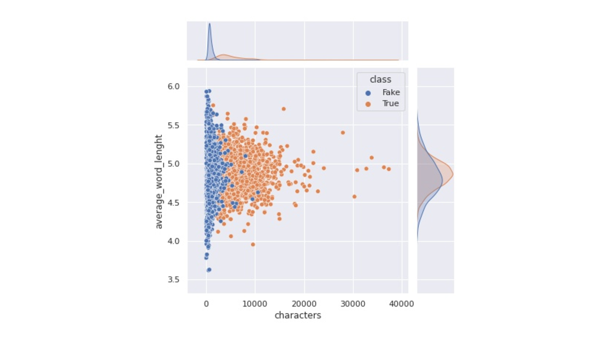
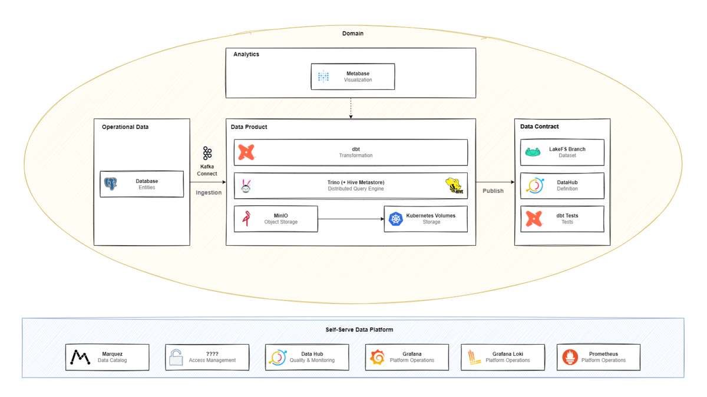
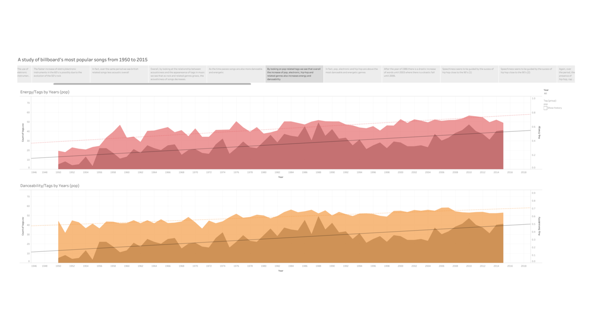
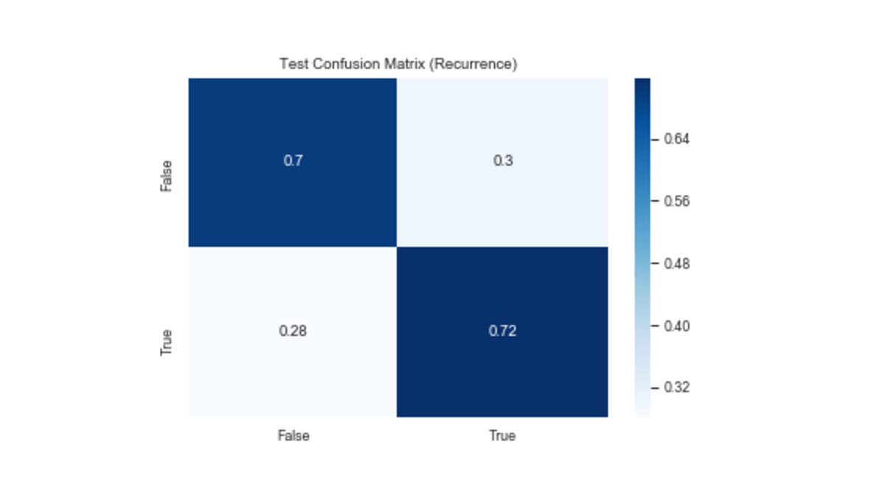

<h3 align="center">
  Hello, I'm Gabriel 👋
</h3>

  <strong>Data Engineer/Architect • AI/ML Engineer</strong> 
  <em>Making data behave so AI can actually work</em>

  
  
  

If it involves data, servers, or models, I’ve probably built it, scaled it, or at least debugged it (whether it was 
my bug or not). My background is a mix of Data Engineering, Machine Learning and Infrastructure which basically means 
I care just as  much about the pipeline not catching fire as I do about the quality of your data. 

Currently exploring AI Engineering, with a soft spot for ML Explainability ("the model said so" is never a good answer). 
Bring a favorite tech topic and a little caffeine, and we can talk about it all day!

  
  
  
  
  
  
  
  
  
  
  
  

### 💡 Things I've Built

<table>
  <tr>
    <!-- Fake News -->
    <td width="50%" valign="top">
      
       
        <strong>📄 Research: Statistical Learning on Fake News</strong> 
        Peer-reviewed study analyzing and detecting misinformation patterns in Brazilian news. 
        <strong><a href="https://doi.org/10.1111/exsy.13171">Read Paper (Expert Systems) ↗</a></strong> &nbsp;•&nbsp; <strong><a href="https://github.com/limagbz/fake-news-ptBR">Source Code ↗</a></strong> 
        #exploratory-data-analysis &nbsp; #nlp &nbsp; #python &nbsp; #sklearn &nbsp; #statistical-models &nbsp;  
    </td>
    <!-- Data Mesh -->
    <td width="50%" valign="top">
      
       
      <strong>🏗️ Architecture: Yelp! Data Mesh</strong> 
      Decentralized data platform implementing domain-oriented ownership and self-serve data infrastructure. 
      <strong><a href="https://github.com/limagbz/data-mesh-yelp">Source Code ↗</a></strong> 
      #data-mesh &nbsp; #kafka &nbsp; #dbt &nbsp; #trino &nbsp; #kubernetes &nbsp; #data-hub &nbsp; #s3 &nbsp; #postgres &nbsp; #grafana 
    </td>
  </tr>
  <tr>
    <!-- Top Billboard Songs -->
    <td width="50%" valign="top">
      
       
      <strong>📊 Storytelling: Billboard & Spotify (1950–2015)</strong> 
      Interactive visual exploration on Tableau of 65 years of hit music and audio trends. 
      <strong><a href="https://public.tableau.com/views/BillboardSpotify/Storytelling?:language=en&:display_count=y&:origin=viz_share_link">Visualization (Tableau) ↗</a></strong> &nbsp;•&nbsp; <strong><a href="https://github.com/limagbz/top_billboard_songs_spotify">Source Code ↗</a></strong> 
      #tableau &nbsp; #data-visualization &nbsp; #data-storytelling &nbsp; #exploratory-data-analysis &nbsp; #music 
    </td>
      <!-- Arrhythmia Alarms -->
    <td width="50%" valign="top">
      
       
      <strong>🫀 AI/ML: ICU Arrhythmia Alarm Detection</strong> 
      Convolutional Neural Network model (VGG16) designed to classify cardiac signals from multiple devices in order to reduce false ICU alarms. 
      <strong><a href="https://github.com/limagbz/arrhythmia-alarms">Source Code ↗</a></strong> 
      #deep-learning &nbsp; #convolutional-neural-networks &nbsp; #vgg16 &nbsp; #python &nbsp; #recurrence-plots 
    </td>
  </tr>
</table>
